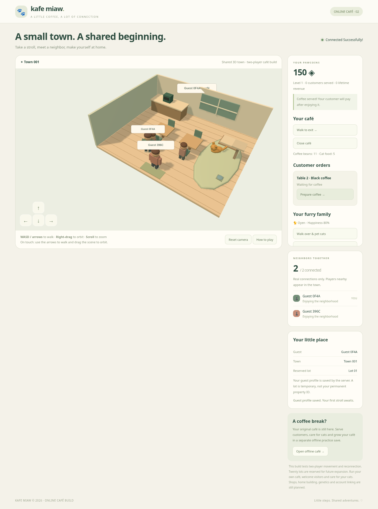

# Kafe Miaw 🐾

**Version 0.3 — playable online café slice.** A shared 3D town with independently owned cafés, real two-browser multiplayer, server-controlled coffee orders, cats, supplies and upgrades. This is not the complete master-spec life simulation or a CrazyGames release.



## Start with the VS Code terminal

Use **Node.js 24+** and Git. No Laragon, PHP, MySQL or separate database installation is needed. In Windows PowerShell, for an existing checkout:

```powershell
Set-Location "$env:USERPROFILE\KafeMiawOnline"
git pull --ff-only
npm.cmd ci
npm.cmd run dev -- --port 5174 --server-port 3002
```

For a fresh checkout, use a new folder:

```powershell
git clone https://github.com/s58fzckmh8-hue/Aiman.git KafeMiawOnline
Set-Location KafeMiawOnline
npm.cmd ci
npm.cmd run dev -- --port 5174 --server-port 3002
```

Open **the localhost address printed by Vite**, not a LAN address. The exact localhost origins are allowed by default. Keep the terminal running. Ctrl+C stops both processes. Use `npm` instead of `npm.cmd` on macOS/Linux. The launcher runs Node directly without a Windows shell wrapper and supports alternate frontend/backend ports. Without flags, the defaults are 5173/3001. Explicit `ALLOWED_ORIGINS` remains authoritative.

Do not overwrite local changes when updating. A folder extracted from ZIP is not a Git checkout; clone into a fresh folder instead.

## Play the online café

1. Choose **Play Online**, then **Walk to my café**. Your character follows a server-generated walking route and enters through the door.
2. Choose **Open café**. The first customer arrives; there are two customer places.
3. Choose **Prepare coffee**. Your character walks to the machine. One bean is consumed atomically; brewing takes four seconds.
4. Choose **Serve coffee** when ready. Your character walks to the customer. The customer drinks, then pays. Only the owner's wallet is credited, once.
5. Pet/feed cats, order supplies, decorate the café or adopt another cat under **Supplies & café upgrades**.
6. Choose **Walk to exit** to return through your entrance. Leaving or disconnecting closes the café, cancels unpaid orders and returns their reserved beans. Completed payments remain saved.

Starter balance: 150 PawCoins, 12 beans, 5 food portions and Oyen. Coffee pays 20 + 3 per decoration level + a 5-coin happy-cat bonus. Two tables, four chairs, three cat slots and three decoration levels are supported. Cat happiness is a simple persistent care stat in this slice; full needs/AI/genetics are not implemented.

WASD/arrows or on-screen arrows move your character. Manual movement cancels a queued walking interaction. Right-drag or touch-drag orbits the camera; scroll zooms. **Reset camera** restores the current area's view. Automatic interactions walk to the appropriate service points rather than crediting distant clicks.

Unpaid orders expire after 60 seconds with a bean refund if preparation consumed a bean. There is no passive money for leaving the server running. Storage caps prevent oversupply. Purchases cannot create negative currency or duplicate items when the same request is retried.

## Try two players

Open the same localhost address in a normal Chrome window and an **Incognito window** or second browser. Join both. They have separate guest profiles and wallets. Choose **Visit café** to walk to an accessible neighbor's property. Both players see each other inside the same café. Visitors may look around but cannot open the café, process orders, buy items or spend the owner's coins. Owners can block new visits; existing visitors may finish their visit.

Two ordinary tabs share one guest cookie: the later connection replaces the earlier connection. Reconnect within 15 seconds to retain the active session and lot. Profile, café, coins and cats remain independent of the temporary lot allocation.

A guest identity is tied to this browser cookie, not a linked cross-device account. Clearing the cookie or losing the server's profile store loses access. The original 2D café remains under **Open offline café**, retaining its local save key and gameplay. Those client-editable offline coins are never imported as trusted online currency.

Two distant PCs cannot share a localhost server. A public online game needs a separately hosted HTTPS/WSS backend. No hosted game URL is provided here.

## Verification

```powershell
npm.cmd test
npm.cmd run typecheck
npm.cmd run test:online
npm.cmd run build
npm.cmd exec -- playwright install chromium
npm.cmd run test:browser
npm.cmd run test:cafe-browser
npm.cmd run test:production
```

The scripts create temporary databases and servers, not real player data. Browser tests need Chromium (Playwright installation, `CHROMIUM_PATH`, or detected `/usr/bin/chromium`). Ports 5199, 5196 and 5197 must be free for the respective browser checks. Screenshots are under ignored `test-results/`.

`npm run build` emits separate online and offline entries in `dist/`; Vite retains a large-bundle advisory. To preview the production frontend, run `npm run server` and `npm run preview` in separate terminals using matching backend port configuration. The static build cannot run the multiplayer simulation by itself.

## Persistence and deployment

The existing private `.local/profiles.json` guest identities are preserved. Online game data is now stored separately in **`.local/profiles.json.game.sqlite`** using Node's built-in SQLite, WAL, checks, foreign keys, atomic transactions, an idempotency ledger and a schema version guard. Café IDs and cat IDs persist independently of room slots. Interrupted orders are cancelled/refunded once on startup. This is a deliberate single-server implementation choice replacing the earlier PostgreSQL-first plan; PostgreSQL remains a candidate for a future distributed deployment.

Keep the complete private `.local/` directory backed up. For a consistent simple backup, stop the server first and copy the whole directory, including SQLite/WAL files. Never include it in a frontend build or Git. It contains identity hashes and private player data. Do not run multiple backend processes against the same data path: room coordination and multi-process simulation are not implemented.

| Variable | Default | Purpose |
|---|---|---|
| `PORT` | `3001` | Backend port; launcher `--server-port` overrides it |
| `VITE_PORT` | `5173` | Frontend port; launcher `--port` overrides it |
| `HOST` | `127.0.0.1` | Backend bind address |
| `PROFILE_PATH` | `.local/profiles.json` | Guest identities; game database uses this path plus `.game.sqlite` |
| `SIMULATION_HZ` | `20` | Validated simulation frequency (10–60 Hz) |
| `REPLICATE_EVERY_TICKS` | `2` | Replication interval; default 10 Hz |
| `RECONNECT_GRACE_MS` | `15000` | Reserved-lot reconnect grace |
| `ALLOWED_ORIGINS` | Local Vite/preview origins | Exact comma-separated permitted origins |
| `NODE_ENV` | development | Production enables Secure cookies and requires explicit HTTPS origins |

Public production hosting must provide trusted HTTPS/WSS, same-origin `/api` and `/ws` routing, persistent private storage and backups. CrazyGames may require a different supported identity/cross-origin strategy; the same-origin development cookie flow is not a verified CrazyGames integration. No SDK, ads, payments, public chat or account linking is shipped.

## Scope and next stages

[Implementation ledger](docs/IMPLEMENTATION.md) · [Validation evidence](docs/VALIDATION.md) · [Multiplayer directive](docs/MULTIPLAYER-DIRECTIVE.md) · [Full design](docs/MASTER-SPEC.md)

**Implemented/tested:** two-browser town movement/reconnect, building transitions, ownership/visitor permissions, independent durable cafés, coffee orders/payments, supply purchases, simple cat care/adoption, fixed decoration upgrades and offline-mode preservation.

**Not complete:** advanced cat needs/AI/breeds/genetics, furniture build mode, homes, functional town shops, employees, recipes beyond black coffee, quests/XP, full tutorials/audio, matchmaking, 5/10/20-player load tests, Internet deployment and CrazyGames readiness. Twenty visible lots are reserved; only two-player sessions have been validated. All geometry and animations are original code primitives, not final commercial assets. Consult package licenses for dependencies.
