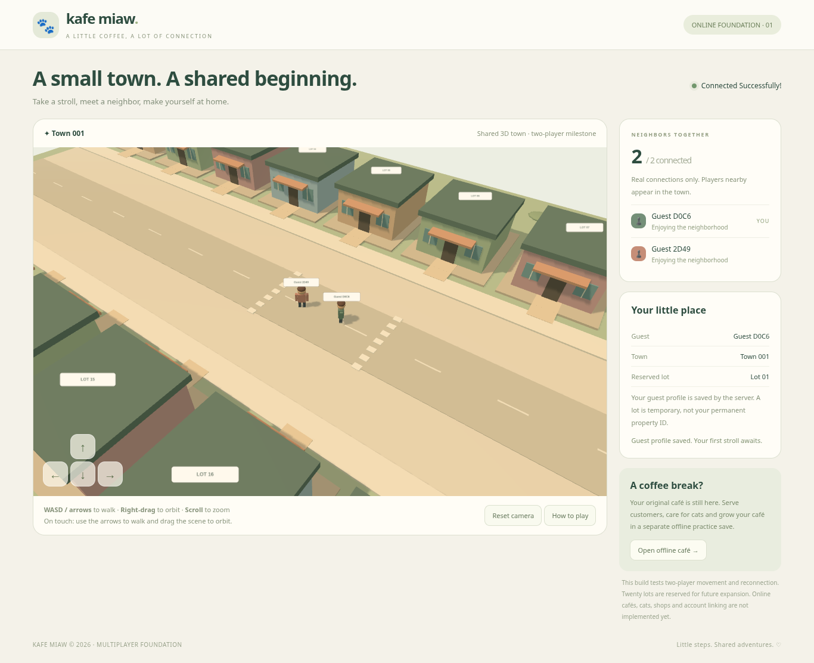

# Kafe Miaw 🐾

A browser game built around a shared 3D cat-café town. **Version 0.2: multiplayer foundation**, not a finished life simulation or CrazyGames release.



*Captured during a local two-browser test; this is not a hosted public town.*

## Start in the VS Code terminal (Windows PowerShell)

Node.js 24 LTS and Git are sufficient. Laragon, PHP, MySQL and a local PostgreSQL installation are **not** required for this milestone.

For a fresh checkout (choose a destination that does not already exist):

```powershell
git clone https://github.com/s58fzckmh8-hue/Aiman.git KafeMiawOnline
Set-Location KafeMiawOnline
npm.cmd ci
npm.cmd run dev
```

For an existing Git checkout, run `git pull --ff-only` first, then `npm.cmd ci` and `npm.cmd run dev`. A folder extracted from ZIP is not a Git checkout; use the fresh-checkout commands in a new folder. Do not overwrite existing local changes.

`npm run dev` starts **both** the Node multiplayer backend (127.0.0.1:3001) and Vite (port 5173). Open the address printed by Vite. Stop with Ctrl+C. Port 5173 must be available; the client uses a strict port so the allowed origin remains predictable.

On macOS/Linux, use `npm` in place of `npm.cmd`.

## Try two real players on one PC

1. In Chrome, open the Vite address and choose **Play Online**.
2. Open the same address in an **Incognito window** (or a second browser) and choose **Play Online**.
3. Move with WASD / arrow keys. Both guests should see each other move and the real connected count should become 2.
4. Refresh one browser and choose Play Online again within 15 seconds. Its identity and reserved lot should remain the same.
5. A second normal tab shares the guest cookie and **replaces** the earlier tab; it is not a new player.

Right-drag to orbit, scroll to zoom, or use Reset camera. Touch users can use the directional buttons and drag the scene to orbit. A help dialog explains the current controls. Only buildings are solid in this initial layout; decorative ground cover has no solid footprint. Building interiors and shop interactions are not implemented in this milestone.

This is local development. Two distant PCs cannot join each other's localhost server. Internet multiplayer needs a separately hosted HTTPS/WSS backend; no hosted multiplayer URL is provided by this change.

## What is implemented

- One authoritative town, tested with **two** concurrent guests; 20 visible lot locations reserved for future expansion.
- Original Three.js town/character primitives, warm lighting, camera follow/orbit/zoom and remote interpolation.
- Server-validated movement at up to 5 world units/second; shared collision/boundaries, input sequence checks, stale-input timeout and rate limiting.
- Server-held guest identity, HttpOnly SameSite cookies, hashed bearer tokens, atomic profile-file writes and guest identity surviving a server restart.
- Connection state feedback, real presence counts, distance-filtered state replication and reconnect grace periods without duplicate residents.
- English player-facing UI. The original Phaser café remains playable under **Open offline café**, with its original local save key, serving/cat care/upgrades and gameplay balance preserved. Offline currency is deliberately not imported as trusted online currency.

A guest identity belongs to this browser cookie. It is **not** a linked account or cross-device recovery mechanism. Clearing cookies or losing the server profile store loses access to the guest identity. No online currency, private inventory or trusted economic transactions are implemented yet.

## Verification

```powershell
npm.cmd test
npm.cmd run typecheck
npm.cmd run test:online
npm.cmd run build
npm.cmd exec playwright install chromium
npm.cmd run test:browser
npm.cmd run test:production
```

The browser test launches two isolated browser clients and a temporary backend/Vite server on port 5199. Chromium uses the Playwright installation, or `CHROMIUM_PATH` if specified; `/usr/bin/chromium` is detected on Linux. Results include screenshots under ignored `test-results/`. Backend test data is temporary and does not affect development guests.

`npm run build` produces both the online entry and offline practice in `dist/`. `npm run preview` previews that production frontend; **also run `npm run server` in another terminal** for online functionality. A static build alone cannot run a multiplayer server. Vite reports a large-chunk advisory, especially for the preserved Phaser entry; the two engines are separate entry bundles.

## Server configuration and deployment boundaries

Development data defaults to `.local/profiles.json` (ignored by Git). Back up this private file outside the public web root if guest identity continuity is needed. It contains token hashes and must never be shipped in the frontend build. One server process is supported. Corrupt storage fails closed rather than resetting guest identities. This simple profile store is not a production economy database; PostgreSQL with transactional/idempotent operations is planned before online purchases or café progress.

| Variable | Default | Purpose |
|---|---|---|
| `PORT` | `3001` | Backend port |
| `HOST` | `127.0.0.1` | Backend bind address |
| `PROFILE_PATH` | `.local/profiles.json` | Private persistent guest profile path |
| `SIMULATION_HZ` | `20` | Validated server simulation rate (10–60 Hz) |
| `REPLICATE_EVERY_TICKS` | `2` | Replication interval in simulation ticks (default 10 Hz) |
| `RECONNECT_GRACE_MS` | `15000` | Reserved-lot reconnect grace |
| `ALLOWED_ORIGINS` | Local Vite/preview origins | Exact comma-separated allowed browser origins |
| `NODE_ENV` | development | Production enables Secure cookies and requires explicit HTTPS origins |

Production must terminate trusted HTTPS, forward `/api` and `/ws` from the same public origin to the backend, and support WebSocket upgrade. Use WSS, persistent private storage, backups and resource/connection limits appropriate to the deployment. CrazyGames hosting may require a separate secure session and cross-origin deployment strategy; this build does **not** claim that its same-origin guest cookie flow works inside CrazyGames. Review platform identity and hosting requirements during that milestone. No CrazyGames SDK, ads, public chat or account linking is integrated.

## Design, plan and evidence

- [Audit, contracts and staged plan](docs/IMPLEMENTATION.md)
- [Validation results and limitations](docs/VALIDATION.md)
- [Multiplayer-first directive](docs/MULTIPLAYER-DIRECTIVE.md)
- [Long-term game specification](docs/MASTER-SPEC.md)

The multiplayer-first directive supersedes the older specification's single-player-first schedule. Online café transactions, customer/ingredient simulation, cats, furniture/build mode, functional shops, homes, employees, genetics, ads, moderation, matchmaking and 5/10/20-player load tests are future stages, not completed features. All 3D models and UI graphics in this milestone are drawn from original code primitives. See dependency packages for their respective licenses.
