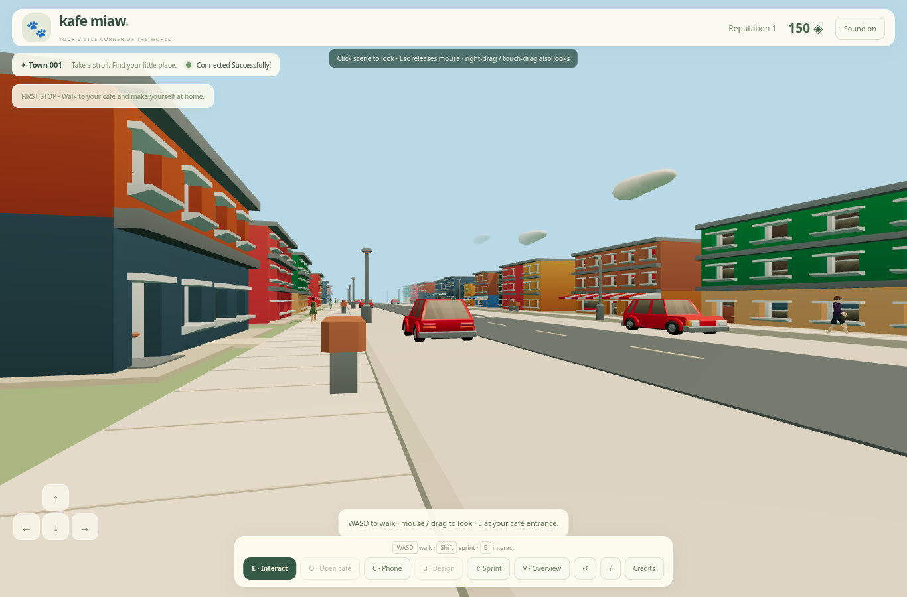

# Kafe Miaw 🐾

**Version 0.6 — first-person city café.** Explore a colourful town at eye height, with imported civilian models, street life, physical coffee service, sitting and cat cuddles. Furniture inventory, expansion and earned progression remain saved. Two real guests can share a town and visit each other. The complete small-world life simulation and CrazyGames release are still in development.



[First-person café service](docs/images/fpp-service.png).

[First-person cat cuddle](docs/images/fpp-cuddle.png) · [Overview carrying pose](docs/images/cafe-cuddle.png).

## Start with the VS Code terminal

Use **Node.js 24+** and Git. No Laragon, PHP, MySQL or separate database installation is needed. In Windows PowerShell, stop the old game with **Ctrl+C in its running terminal** before reinstalling dependencies (Windows locks a running `esbuild.exe`). For an existing working v0.5 checkout, dependencies are unchanged; stop the old server, then:

```powershell
Set-Location "$env:USERPROFILE\KafeMiawOnline"
git pull --ff-only
npm.cmd run dev -- --port 5174 --server-port 3002
```

Use `npm.cmd ci` when dependencies are missing or the dependency entries in the lockfile change. For a fresh checkout, use a new folder:

```powershell
git clone https://github.com/s58fzckmh8-hue/Aiman.git KafeMiawOnline
Set-Location KafeMiawOnline
npm.cmd ci
npm.cmd run dev -- --port 5174 --server-port 3002
```

Open **the localhost address printed by Vite**, not a LAN address. The exact localhost origins are allowed by default. Keep the terminal running. Ctrl+C stops both processes. Use `npm` instead of `npm.cmd` on macOS/Linux. The launcher runs Node directly without a Windows shell wrapper and supports alternate frontend/backend ports. Without flags, the defaults are 5173/3001. Explicit `ALLOWED_ORIGINS` remains authoritative.

Do not overwrite local changes when updating. A folder extracted from ZIP is not a Git checkout; clone into a fresh folder instead.

## Play the online café

**First-person is the default.** Click the scene to capture the mouse and look around; Escape releases it. Right-drag or touch-drag also looks. Your own head is hidden, while carried coffee and cats appear in your hands. **V** switches to overview; **B** uses overview for furniture design and returns to your selected view when finished.

1. Choose **Play Online**. Press **C** to open the in-game phone and choose **Walk to my café**, or walk to your door and press **E**. The camera follows the doorway crossing in the same scene.
2. Press **O** inside your café to open or close it. Named customers arrive with individual orders and patience. Aim at a customer and press E (or click in overview) to select their order.
3. Walk to the coffee machine and aim at it. A distant interaction can also queue a walking approach. **Hold the machine with mouse/touch, or hold E nearby**, for the full recipe time. Releasing early, walking away or losing hold updates cancels brewing and refunds the bean.
4. Click the machine or press E to pick up the ready cup. Walk to the matching customer, then click them or press E nearby to serve. They drink and pay the owner once. The phone cannot prepare or deliver coffee.
5. Aim at a free chair and press E, or click it in overview, to approach and actually sit. **E** or movement stands up. Aim at your cat and press E, or click them in overview, to approach and pick them up; **E** puts them down. Cats walk, rest, groom, play, approach customers and climb their perches. Wait for a perched cat to come down before picking them up.
6. Close the café and press **B** to arrange furniture. Select a group, click the floor or drag, and press **R** to rotate. Bought furniture enters the phone's inventory first; **Place** selects it for the room, and **Store** puts a piece away. The server checks ownership, collisions, clear entrances and work routes. Keep a food bowl placed.
7. Use the phone to buy supplies, adopt a selected coat/tier, purchase cat slots, expand the room and claim completed goals. The phone also contains visitors and the separate offline practice entry.

| Control | Action |
|---|---|
| WASD / arrows | Walk relative to your look direction; cancels queued routes |
| Click scene / Escape | Capture / release desktop mouse |
| V | First-person / overview; click floor walks in overview |
| Shift | Sprint with empty hands |
| E / on-screen Interact | Nearby interaction; hold at the machine to brew |
| O | Toggle your café open/closed |
| C | Open/close the phone |
| B / R / Escape | Arrange / rotate / finish arranging |
| Mouse / right-drag / touch-drag | Look around in first-person; orbit in overview |
| Scroll | Zoom in overview |

The screen also includes movement, interaction, sprint and management controls for touch. Sound unlocks after a user gesture and can be muted.

Starter: **150 PawCoins, 12 beans, 5 food portions, Oyen (Basic), one owned cat slot**. Slots and cats are separate purchases. The next slot costs 50 × the current slot count. Building levels allow 3, 6 and finally 10 owned slots; expansion also increases usable floor space. Eight coat designs span Basic/Common/Rare/Epic/Legendary. Happiness activates a limited rarity bonus; all happy cats can contribute to the basic care bonus.

Black coffee takes 4 seconds. Serving 3 customers unlocks oat latte (5 seconds, +8 coins); 8 unlocks cocoa mocha (6 seconds, +15). Payment is 20 + 3 × building level + recipe bonus + happy-cat bonus (5) + capped rarity bonus (maximum 20). Reputation grows from completed service, and five one-time goals award earned currency. Customers expire after 60 seconds; there is no passive money while inactive.

Leaving or disconnecting closes your café and cancels/refunds unpaid work. Paid orders, purchases, goal claims and furniture layout stay saved. Cat routines and current shift reports are live-session state; full needs decay, staff, desserts, outdoor cat transport and homes remain future work.

## Try two players

Open the same localhost address in a normal Chrome window and an **Incognito window** or second browser. Join both. They have separate guest profiles and wallets. Choose **Visit café** to walk to an accessible neighbor's property. Both players see each other inside the same café. Visitors may sit, pet cats and feed them using their own food. They cannot carry the owner's cats, rearrange furniture, process orders or spend the owner's money. Owners can block new visits; existing visitors may finish their visit.

Two ordinary tabs share one guest cookie: the later connection replaces the earlier connection. Reconnect within 15 seconds to retain the active session and lot. Profile, café, coins and cats remain independent of the temporary lot allocation.

A guest identity is tied to this browser cookie, not a linked cross-device account. Clearing the cookie or losing the server's profile store loses access. The original 2D café remains under **Open offline café**, retaining its local save key and gameplay. Those client-editable offline coins are never imported as trusted online currency.

Two distant PCs cannot share a localhost server. A public online game needs a separately hosted HTTPS/WSS backend. No hosted game URL is provided here.

## Verification

```powershell
npm.cmd test
npm.cmd run typecheck
npm.cmd run test:online
npm.cmd run test:assets
npm.cmd run build
npm.cmd exec -- playwright install chromium
npm.cmd run test:browser
npm.cmd run test:cafe-browser
npm.cmd run test:life-browser
npm.cmd run test:fpp-browser
npm.cmd run test:production
```

The scripts create temporary databases and servers, not real player data. Browser tests need Chromium (Playwright installation, `CHROMIUM_PATH`, or detected `/usr/bin/chromium`). Ports 5199, 5196, 5198 and 5197 must be free for the respective browser checks. Screenshots are under ignored `test-results/`.

`npm run build` emits separate online and offline entries in `dist/`; Vite retains a large-bundle advisory. To preview the production frontend, run `npm run server` and `npm run preview` in separate terminals using matching backend port configuration. The static build cannot run the multiplayer simulation by itself.

## Persistence and deployment

The existing private `.local/profiles.json` guest identities are preserved. Online game data is now stored separately in **`.local/profiles.json.game.sqlite`** using Node's built-in SQLite, WAL, checks, foreign keys, atomic transactions, an idempotency ledger and a schema version guard. Café IDs and cat IDs persist independently of room slots. Interrupted orders are cancelled/refunded once on startup. This is a deliberate single-server implementation choice replacing the earlier PostgreSQL-first plan; PostgreSQL remains a candidate for a future distributed deployment.

Keep the complete private `.local/` directory backed up. For a consistent simple backup, stop the server first and copy the whole directory, including SQLite/WAL files. Never include it in a frontend build or Git. The development server explicitly denies HTTP access to `.local/`. It contains identity hashes and private player data. Do not run multiple backend processes against the same data path: room coordination and multi-process simulation are not implemented.

| Variable | Default | Purpose |
|---|---|---|
| `PORT` | `3001` | Backend port; launcher `--server-port` overrides it |
| `VITE_PORT` | `5173` | Frontend port; launcher `--port` overrides it |
| `HOST` | `127.0.0.1` | Backend bind address |
| `PROFILE_PATH` | `.local/profiles.json` | Guest identities; game database uses this path plus `.game.sqlite` |
| `SIMULATION_HZ` | `20` | Validated simulation frequency (10–60 Hz) |
| `REPLICATE_EVERY_TICKS` | `2` | Replication interval; default 10 Hz |
| `RECONNECT_GRACE_MS` | `15000` | Reserved-lot reconnect grace |
| `ALLOWED_ORIGINS` | Local Vite/preview origins | Exact comma-separated permitted origins |
| `NODE_ENV` | development | Production enables Secure cookies and requires explicit HTTPS origins |

Public production hosting must provide trusted HTTPS/WSS, same-origin `/api` and `/ws` routing, persistent private storage and backups. CrazyGames may require a different supported identity/cross-origin strategy; the same-origin development cookie flow is not a verified CrazyGames integration. No SDK, ads, payments, public chat or account linking is shipped.

## Scope and next stages

[Implementation ledger](docs/IMPLEMENTATION.md) · [Validation evidence](docs/VALIDATION.md) · [Multiplayer directive](docs/MULTIPLAYER-DIRECTIVE.md) · [Full design](docs/MASTER-SPEC.md)

**Implemented:** default first-person camera, pointer lock with drag fallback, first-person cups/cuddles and seated eye height; a street with eight façade variants, parked cars, benches, lamps, foliage and ambient pedestrian NPCs; two-browser town movement/reconnect and visits; durable server-controlled café economy; physical recipe service; articulated human sitting/carrying poses; cat routines/cuddles and paid slots; visitor care; furniture inventory/placement/rotation; room expansion; reputation, goals, shift reports and procedural sound.

**Still to build:** functional town shops, owned homes/cat lounge, cars/driving, outfits, desserts, staff/wages, full cat needs/genetics, a real rewarded-ad integration, account linking, matchmaking, larger-player load tests and public HTTPS/WSS hosting. See the accepted [small-world direction](docs/WORLD-DIRECTION.md). Ad rewards are not simulated.

The local art collection contains **27 verified CC0 GLBs**; four civilian humans/animations are by Quaternius, distributed as converted GLBs in a pinned Ducz archive. KayKit provides street, car and furniture models. Kafe Miaw supplies cats, hands, runtime seated/carrying poses, coffee machine and sound. Home furnishings remain reserved for later gameplay. Parked cars are solid scenery; driving is still future work. See [sources and licenses](docs/ASSETS.md). Imported models alone do not implement a functional shop or driving system.
